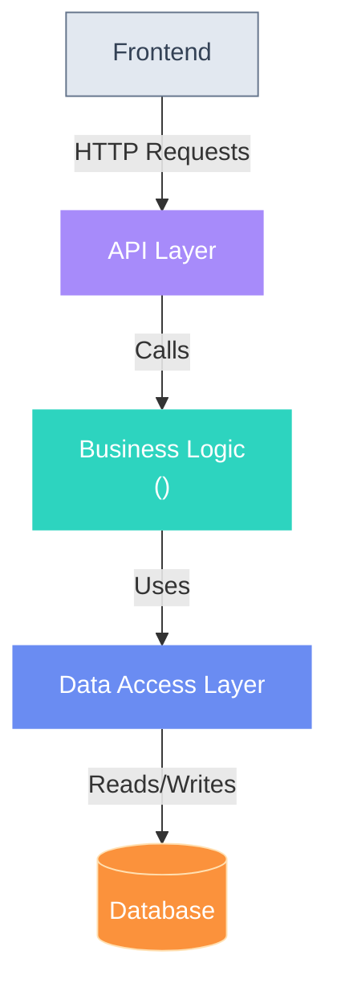

# isef01-lernzeit-manager

## Contribute

Install dependencies

```
pip install uv
uv venv
source .venv/bin/activate
uv sync
```

### CI/CD

Every push and and PR to main will run some code quality checks (ruff linting, formatting and mypy typing).

A pre-commit hook is in place:
```
pip install pre-commit
pre-commit install
```

### Manually Deploy and Test UI

Run App
```
uvicorn isef01_lernzeit_manager.main:app --reload
```

### Code Architecture & Project Structure

This section describes the code architecture under `src/isef01_lernzeit_manager`




| Block | Location in this project | Stack | Responsibility |
| --- | --- | --- | --- |
| **Frontend** | [`templates/`](src/isef01_lernzeit_manager/templates/index.html) and [`static/`](src/isef01_lernzeit_manager/static/) | HTML and CSS | Renders pages & sends HTTP requests to  `/api/...`. |
| **API Layer** | [`main.py`](src/isef01_lernzeit_manager/main.py) | Python and FastAPI | Defines HTTP routes, converts HTTP input/output, and calls business-logic services. |
| **Business Logic** | [`services/`](src/isef01_lernzeit_manager/services/) | Python | Contains use cases and domain rules. No direct HTTP or SQL logic. |
| **Data Access Layer** | [`persistence/`](src/isef01_lernzeit_manager/persistence/) | Python | Translates domain operations into database queries. |
| **Database** |  tbd | tbd | Configuration or public test data. |


### Tests

tbd
